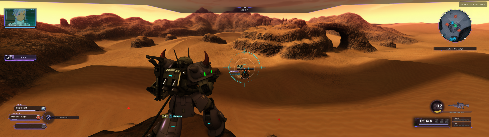

# NoisyFairy

**NoisyFairy** is a Windows port of the PS4 runtime for *Mobile Suit Gundam Battle Operation Code Fairy*. It is a game-specific **Windows port** of [HekamiAeon/GBO-Code-Fairy-PS4RT](https://github.com/HekamiAeon/GBO-Code-Fairy-PS4RT), a compatibility runtime for **MOBILE SUIT GUNDAM BATTLE OPERATION Code Fairy** (PlayStation 4, **CUSA28763, v01.03**). All of the runtime design, PS4 service layers and game-specific work come from **Hekami's original Linux project**; this repository adapts it to run natively on Windows 10/11 and is not affiliated with it. See [Credits](#credits-and-licensing).

PS4RT runs prepared original PS4 x86-64 game code through Windows-hosted PS4 service compatibility layers and a **shadPS4-derived Vulkan renderer**. It is **not** a general PS4 emulator, a recreation of the game, or a substitute for owning the game.

  

**Bring your own game and volume unlock keys.** To access Code Fairy's three episodic volumes, you need **(1) the extracted CUSA28763 game, (2) game version v01.03 in PKG format, and (3) all three volume unlock-key PKGs**. If your extracted game is already v01.03, you do not need to apply a separate update PKG. The volume keys are **not optional gameplay DLC**: they unlock the corresponding episodes already in the game, and the game will not progress past the title screen if you don't own Volume 1 at least. 

PS4RT neither supplies these files nor bypasses the game's volume locks. No PS4 firmware, user saves, decrypted executables or PlayStation Network authentication is provided. This project is independent of the game's rights holders, Sony and AMD.

## Download and play

1. Download the latest build from the **Releases** page (if it is split in parts, follow [WINDOWS-PORT.md](WINDOWS-PORT.md) to join them) and extract it to a short, writable path such as `C:\CodeFairy\`.
2. Open a `cmd` window in that folder and run `Play-Game.bat --game "C:\path\to\extracted\CUSA28763"`. Running from `cmd` keeps the log visible; add `> log.txt 2>&1` to save it.
3. Follow the setup window for the v01.03 update and volume keys if needed.

After successful setup the game path is remembered, so later sessions only need `Play-Game.bat`. Pass `--game` again if you move the game folder, and `--dlc-pkg <path>` to install volume keys later (also available from the Insert overlay). If you are going to install DLC keys seperately through CLI, make sure to include the `.pkg` extension.

Requirements: Windows 10 1803+ (64-bit) and a Vulkan 1.3 GPU. Full guide: [Running on Windows](docs/RUNNING_WINDOWS.md).

### Required v01.03 game version and episodic volume keys

**Code Fairy v01.03 is required.**

- **Already have extracted v01.03:** PS4RT validates and prepares the game directly.
- **Have extracted v01.00:** The integrated setup asks for your own matching **CUSA28763 v01.03 update PKG** and applies the update before launching.
- **Important:** Applying that update **modifies the selected extracted CUSA28763 directory in place**. Back up the original v01.00 directory beforehand if you need to preserve it for another application. Your source PKG is not modified.
- **Three volume unlock-key PKGs are required to access all three volumes.** Code Fairy is episodic: these keys unlock existing story content; they are not conventional add-on DLC. After applying an update, PS4RT may offer a package picker. You can skip it to finish setup, but the volumes remain locked until their keys are installed. You can install the keys later using **Install DLC...** in the Graphics overlay by pressing 'Insert.'
- If setup is interrupted, rerun the launcher and supply the same update PKG to repair the installation.

See [Player update and volume-key setup](docs/PLAYER_PKG_SETUP.md) for detailed steps and command-line alternatives.

### Graphics and controls

Open the PS4RT menu with **Insert** on the keyboard, or **hold L2 and click R3** on a controller. Use the D-pad to navigate, Cross to select, and Circle to return. The menu separates **Graphics** from **Achievements**, with Code Fairy's compact two-tab layout. The Graphics page also provides FPS and game-related controls.

Available features include:

- **Internal resolutions & UltraWide Support:** 1024×576 (the low-end “540p” option), 720p, 1080p, 1440p, 2160p/4K, plus **21:9, 24:9 and 32:9 ultrawide** modes up to 5120×1440. Internal resolution changes require restarting.
- **Upscaling:** Off, **FSR 1**, **FSR 3.1**, or **FSR 4 v07** on capable hardware. FSR reconstructs the 3D scene before the HUD is composited; output resolution is selected separately, within the same aspect-ratio family. Upscaler selection is live.
- **Graphics quality:** **Max (original)**, **Medium**, and **Low**. Medium reduces the 4096² sun-shadow atlas to 2048²; Low uses 1024². Restart required.
- **Frame rate:** The game's original **60 FPS** behavior, with an optional **30 FPS cap** for weaker devices.
- **Anisotropic filtering** (game default, 2×, 4×, 8×, 16×), sharpening, display options, and an FPS counter.
- **Local achievements:** The game triggers trophy unlocks; the PS4RT overlay saves and displays progress, earned timestamps, icons and hidden entries. This is **not PSN trophy synchronization**, and previously completed objectives are not guaranteed to unlock retroactively.
- **Volume key installation:** Use the overlay's existing **Install DLC...** button for the three volume unlock-key PKGs. The button retains its generic name because the keys use the same PS4 add-on package mechanism; **no separate DLC is required**. Save and restart after installing keys so the game recognizes the unlocked volumes.

The in-game menu also offers **FSR 1** and the finer-grained internal/ultrawide choices; not every menu option has a launcher flag. See [Running on Windows](docs/RUNNING_WINDOWS.md) for details.

## Current compatibility status

**Windows port:** tested on Windows 10 with a GTX 1050 Ti. It boots to the main menu and plays through the Chapter 1 tutorial; trophy unlocks no longer crash, and save data loads correctly after restart. Boots on GTX 10-series and RTX 30/50-series cards (0.4 Alpha). Chapters beyond that and Volume 2/3 are untested on Windows, and the port should be treated as an alpha.

**Original Linux build (by Hekami):** playable and tested through Chapter 9 (Volume 2) on a Radeon 9070XT and Ryzen 9700X, covering the tutorial, story missions, combat and bosses, cutscenes, menus, saving/loading and completion of Volume 1. Volume 3 has not been fully gameplay-tested. Screenshots document a particular configuration, not a performance guarantee.

Known limitations and notes:

- **Ultrawide is experimental.** Some camera-driven HUD elements, may appear misplaced or flicker. Reproduce at 16:9 before reporting a widescreen-specific regression. Cutscenes and pre-recorded videos remain at 16:9 aspect ratio as they were designed for that size and can look distorted otherwise. 
- **FSR 4 v07** needs compatible Vulkan GPU features; use FSR 3.1, FSR 1 or Off where unsupported.
- **30 FPS mode** is intended for lower-power hardware. The runtime may lift the limiter for 60 FPS video playback to avoid the videos playing at half speed and during dialogue as they are less intensive.
- FPS depends heavily on GPU power, internal resolution, graphics-quality preset and shader/cache state.
- **Older GPUs (Pascal / GTX 10-series and earlier) may show model glitches**: on a GTX 1050 Ti, weapon and shoulder parts on some Zakus (Chapter 1) render with missing polygons or colored dots until the camera gets close. The cause appears to be GPU-side (a compute shader that builds the recolored textures), not a setting. Toggling the optimization, MSAA, barrier and interpolation options made no difference. Newer GPUs are expected to be better; reports welcome.
- **CPUs older than Coffee Lake (or equivalent) may be missing required functions** Another user tested with an i5-3470, which is missing MOVBE, BMI1, and LZCNT instructions. Your mileage may vary. If your CPU is too old, there's no real chance for support.
- **Backups:** the `savedata-backups` snapshot copy is best-effort; saving itself does not depend on it.
- **Known deadlock risk** in the model manager (Chapters 1, 3, 5 per Hekami); see [WINDOWS-MUTEX-NOTES.md](docs/WINDOWS-MUTEX-NOTES.md).
- **DLSS is not available** in Windows builds (FSR 1/3.1/4 are).
- Version **v01.03 / CUSA28763** is the tested and required title combination. Other title IDs or executable versions are unsupported.

Please report reproducible defects on the **published project's GitHub Issues page** with your game version, mission/chapter, GPU/driver, resolution, graphics preset, upscaler and reproduction steps. For visual problems, also include whether they reproduce in 16:9 with FSR Off.

## Build from source (developers)

Players should use a release. The Windows binaries are **cross-compiled from Linux** with clang and MinGW-w64; see [docs/windows-build/NOTES.md](docs/windows-build/NOTES.md), `docs/windows-build/link.sh` and `docs/windows-build/toolchain-clang-mingw.cmake`. There is no native Windows build script yet.

Generated state lives under `out\CUSA28763\` (prepared game code, saves, trophies, caches, volume keys). **Never publish or commit `out\`.** See [Windows data layout](docs/WINDOWS_DATA_LAYOUT.md).

## Documentation

- [Running on Windows](docs/RUNNING_WINDOWS.md)
- [Update and volume-key setup](docs/PLAYER_PKG_SETUP.md)
- [Windows package and data layout](docs/WINDOWS_DATA_LAYOUT.md)
- [Mutex/deadlock notes](docs/WINDOWS-MUTEX-NOTES.md)
- [Cross-build notes](docs/windows-build/NOTES.md)
- [Upstream source credits and licensing](docs/UPSTREAM_CREDITS.md)

## Credits and licensing

**Original project:** huge thanks to **[HekamiAeon](https://github.com/HekamiAeon)** for [GBO-Code-Fairy-PS4RT](https://github.com/HekamiAeon/GBO-Code-Fairy-PS4RT), the Linux runtime this port is built on (GPL-2.0-or-later). Without that work there would be nothing to port.

PS4RT adapts open-source compatibility runtimes and renderer work from **gow3_pc**, **bloodborne_pc**, **shadPS4** and related contributors. The integrated PKG extractor is adapted from **AzaharPlus/shadPS4Plus**. Local trophy handling also incorporates work credited in `scripts/trophy_crypto.py`. REA and Ghidra were used for analysis, not bundled as runtime dependencies.

Runtime source is **GPL-2.0-or-later**; third-party code, fonts, shaders and media retain their individual terms. Refer to [Upstream credits and notices](docs/UPSTREAM_CREDITS.md), [LICENSE](LICENSE) and [FSR 4 asset notice](fsr4_shaders/LICENSE-FSR4-v07.txt). No copyright or trademark ownership of the underlying game is claimed.
